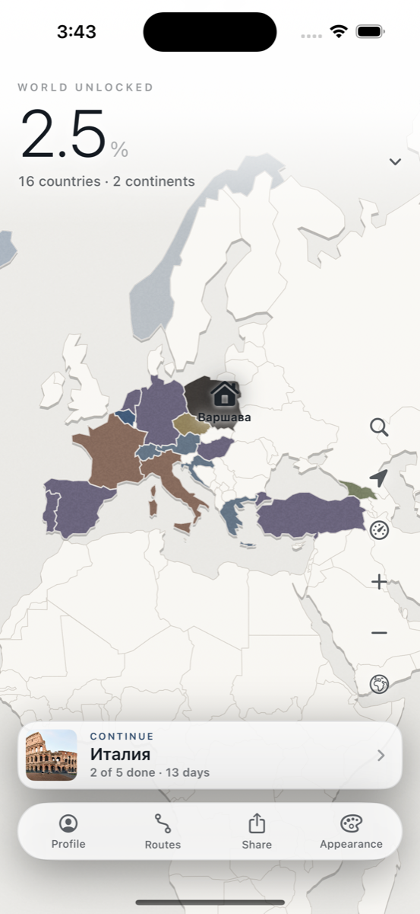

# MAPA

A cinematic travel map for iOS: mark the countries you have seen, plan routes
city by city, and watch your share of the world fill in.

Built with SwiftUI. The map is drawn from scratch — no MapKit, no tiles: country
polygons are rendered in a `Canvas`, so the whole world works offline and the
look is fully ours.

## Screenshots



<!-- More screenshots go in the table below once captured: a country card, a
     route with photos, the statistics panel, a frame from the exported video.

| | |
| --- | --- |
|  |  |
|  |  |
-->

## Features

- **World map** — 176 countries drawn as vector polygons, pan and pinch with a
  clamped camera, country and city markers that appear with zoom.
- **Travel status** — every country is *visited*, *living* or *wishlist*.
  Wishlist never counts towards progress: it is a wish, not a fact.
- **Statistics** — the share of the world's land you have explored, measured by
  **area** rather than country count, with per-continent progress.
- **Country cards** — a silhouette of the country, facts for 128 countries and
  things to see in 412 cities.
- **Routes** — multi-stop routes with days, a budget per stop in euros, notes, a
  photo per point, visited flags, and reviews with a 1–5 rating.
- **Search** — countries and cities by name, in both languages.
- **Video export** — a vertical 1080×1920 clip of your map for social networks,
  rendered frame by frame straight to disk.
- **Profile** — avatar from a built-in icon set or your own photo; the backend is
  optional (see below).
- **Localization** — Russian and English, including plural rules.
- **Accessibility** — Reduce Motion and Reduce Transparency are respected by
  construction, see the design-system rules below.

## Architecture

```
MAPA/
  App/            entry point and root view
  Core/           models and services, no UI
  DesignSystem/   tokens, motion, haptics, components
  Features/       screens (Map, Country, City, Route, Stats, Search,
                  Export, Account, Theme, Gallery)
  Resources/      geodata, facts, localization, assets
MAPATests/        27 unit tests
Tools/            Xcode project generator and data builders
supabase/         optional backend: schema and setup notes
```

Two ideas hold the project together.

**Storage sits behind protocols.** `TravelLogStorage` and `RouteStorage` are
protocols; today both are backed by JSON files in Application Support with
atomic writes and a `version` field in the payload, so moving a store to
SwiftData or to a server is a one-line change at the call site and a one-off
migration, not a rewrite. Marks and routes deliberately use *separate* stores:
routes are meant to become shared, marks stay private.

**Screens never hardcode style.** Colours, sizes, typography and animation all
come from `DS.*`; every animation goes through `@Environment(\.dsMotion)`, which
is how Reduce Motion works everywhere at once. Any `.ultraThinMaterial` ships
with an opaque fallback for Reduce Transparency. Standard `List` and `Form` are
not used.

Route points store their own coordinates instead of referencing a city id, so a
route survives any rebuild of the city catalogue and reads correctly even when
shown without the map. Photos are referenced by file id — a route travels as
JSON, and inlined megabytes would turn every read into a visible pause.

## Data

Both datasets come from [Natural Earth](https://www.naturalearthdata.com)
(public domain) and are preprocessed into the bundle.

| File | What it is |
| --- | --- |
| `Resources/world_110m.geojson` | 176 countries, 10 298 points, 200 KB — Natural Earth 1:110m with 163 of 168 attributes dropped, coordinates rounded, contours simplified, area computed per country |
| `Resources/cities.json` | 871 cities from Natural Earth 1:50m, up to six per country, each with a Russian name |
| `Resources/country-facts.json` | facts for 128 countries |
| `Resources/city-facts.json` | things to see in 412 cities |

Rebuild the borders:

```bash
curl -L -o /tmp/ne_110m.geojson \
  https://raw.githubusercontent.com/nvkelso/natural-earth-vector/master/geojson/ne_110m_admin_0_countries.geojson
python3 Tools/build_borders.py /tmp/ne_110m.geojson
```

Rebuild the cities:

```bash
curl -L -o /tmp/ne_cities.geojson \
  https://raw.githubusercontent.com/nvkelso/natural-earth-vector/master/geojson/ne_50m_populated_places_simple.geojson
cd Tools && python3 build_cities.py /tmp/ne_cities.geojson
```

Cities are picked six per country by significance, with capitals weighted four
times by population. Russian names live in `Tools/city_names_ru.py` — the source
data has none — and the script reports any city that reaches the bundle without
a translation. City-states (Singapore, Monaco, Vatican) are skipped: the 1:110m
borders give them no polygon to attach to. Antarctic stations are skipped too.

The 1:110m data holds up to roughly 14× zoom; beyond that the coastline breaks
into visible segments, which is what `MapCamera.maxZoom` is set from. Moving to
1:50m would raise the ceiling at the cost of bundle size.

## Build and run

Requirements: Xcode 14.2 or newer, iOS 16.0 deployment target.

`MAPA.xcodeproj` is generated from the contents of `MAPA/` — the committed copy
is there so the project opens in one click, but the generator is the source of
truth. After adding or removing a file, rerun it instead of editing
`project.pbxproj` by hand:

```bash
python3 Tools/generate_project.py
open MAPA.xcodeproj
```

## App icon

A route of five stops folded into the letter M — the name and what the app
does in one shape. Drawn by a script, not stored as a picture, so the colours
stay tied to the palette and the icon can be changed in one line:

```bash
swift Tools/make_icon.swift
```

## Store materials

`store/` holds the App Store listing in both languages, and `docs/` holds the
privacy and support pages the submission form requires as URLs. Screenshots
are generated, not stored — Apple wants 1290×2796, five per language:

```bash
Tools/make_screenshots.sh screenshots
```

## Promo video

A 26-second walkthrough, assembled from real screens of the running app:
screenshots are taken through the same environment-variable harness, frames
are drawn by a Swift script (gradient, device, caption) and stitched by
ffmpeg. Rebuild it after any visible change:

```bash
Tools/make_promo.sh build/promo
```

## Checks

```bash
# 39 unit tests: projection, camera, hit testing, type scale, reading older
# route files, statistics, catalogue integrity, search.
xcodebuild test -project MAPA.xcodeproj -scheme MAPA \
  -destination 'platform=iOS Simulator,name=iPhone 14 Pro'

# Cities against country borders: one capital per country, coordinates inside
# the right country.
python3 Tools/check_cities.py

# Interface strings: build the Russian table and report what the English one
# is missing.
python3 Tools/extract_strings.py
```

## Backend (optional)

The app is fully usable with no server at all: map, routes and ratings live on
the device. A Supabase project adds only what needs a second person — shared
routes, avatars, photos.

Credentials are read at runtime from `MAPA/Resources/Supabase.plist`, which is
**not** in the repository and must not be: the key belongs to one project, and
keeping it in shared code is how keys end up public. Setup steps and the SQL
schema are in [`supabase/README.md`](supabase/README.md).

## Licence

MIT — see [LICENSE](LICENSE). The bundled Natural Earth data is public domain.
